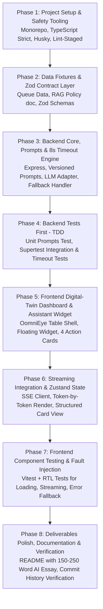

# Implementation Plan: OomniEye Approvals AI Assistant
**Role**: Sr. Fullstack Developer — MERN + AI (Wave 2 Technical Assignment)  
**Project**: Crystal Ball Command Centre · Digital-Twin Approvals Assistant Panel  

---

## 1. Executive Summary & Objective

Rebuild the **OomniEye Digital-Twin Approvals Assistant** panel as a fully functional, production-ready fullstack web application. Every action inside the assistant widget is powered by a real, server-side Large Language Model (LLM) decision layer (OpenAI GPT-4o / Anthropic Claude 3.5 Sonnet) with token-by-token streaming, strict Zod schema validation, an in-memory RAG surface for operational Q&A, an 8-second timeout with non-AI graceful degradation, and comprehensive automated test coverage (Unit, Integration, Component).

---

## 2. Technology Stack & Tooling

| Domain | Technology / Library | Role & Justification |
| :--- | :--- | :--- |
| **Frontend Framework** | **Next.js 14+ (App Router) & React 18+** | Matches spec (`React + Next.js`). Clean server/client separation, fast rendering. |
| **Styling & Theme** | **Tailwind CSS + CSS Modules** | Matches OomniEye enterprise digital-twin aesthetic (glassmorphism, subtle borders, sleek dark/light balance). |
| **Client State Management** | **Zustand** | Explicitly specified (`Zustand or React Query`). Manages conversation turns, streaming tokens, widget states without prop drilling. |
| **Streaming Protocol** | **Server-Sent Events (SSE) / Fetch `ReadableStream`** | Token-by-token streaming UI; zero spinner-then-dump experience. |
| **Backend Framework** | **Node.js + Express (TypeScript Strict Mode)** | Decoupled, modular API server with full Supertest testability and strict type safety. |
| **Data Validation & Contracts** | **Zod (`zod`)** | OpenAPI-first spirit. Request/response validation and LLM structured output parsing. |
| **LLM Orchestration** | **OpenAI SDK / Anthropic SDK + Mock Mode** | Server-side only (never exposing keys). Includes automated mock provider for zero-key test evaluation. |
| **RAG / Grounding Engine** | **In-memory Vector / Keyword Retriever** | 3–5 chunks over the 200–400 word operational policy document for *"Help me"*. |
| **Rate Limiting** | **`express-rate-limit`** | Per-session throttling on AI endpoints. |
| **Resilience & Timeouts** | **Custom AbortController (8s limit)** | Prevents raw 500s or frozen UIs; routes to deterministic fallback data. |
| **Testing Suite** | **Vitest / Jest + Supertest + React Testing Library** | Unit (prompts/parser), Integration (Supertest timeout fallback), Component (streaming & errors). |
| **Git Safety & Quality** | **Husky + lint-staged + Commitlint + Prettier + ESLint** | Production-grade safety hooks verifying types, linting, and tests on commits and pushes. |

---

## 3. Reference Dataset & RAG Grounding Document

### 3.1 Approvals Queue Fixture (`approvalsQueue.json`)
The assistant reasons over the following 4 mock items seeded in the repo:

| # | Item Name | Type | Submitted By | Status |
| :--- | :--- | :--- | :--- | :--- |
| 1 | **Site Patrol Onboarding & Checklists** | Folder | Sam HelpAdmin | `Pending Review — Sep 18` |
| 2 | **Level 2 Drone Patrol Video Demo** | Video | Alex HelpAdmin | `Pending Review — Sep 18` |
| 3 | **Safety Equipment & Sensor Specs** | PDF | Sam HelpAdmin | `Pending Review — Sep 18` |
| 4 | **360° Spatial Zone Layout & Camera Map** | Image | Elena HelpAdmin | `Pending Review — Sep 18` |

### 3.2 Operational Policy Note (`approvalPolicy.md` - 300 words)
The RAG grounding surface for the *"Help me"* operational assistant:
- **Chunk 1: Drone Patrol Video Standards**: Mandatory 60fps check, timestamp validation, spatial boundary tagging, and pilot certification compliance.
- **Chunk 2: Sensor & Safety Sign-offs**: OSHA compliance certifications required, calibration expiry checks (< 30 days requires rejection).
- **Chunk 3: Spatial Zone & Camera Maps**: Blind-spot overlap validation (min 15% overlap between adjacent cameras), resolution threshold verification.
- **Chunk 4: Escalation & SLA Protocol**: Any item pending > 72 hours requires automated escalation to Shift Supervisor.

---

## 4. The 5 Core AI Entry Points & Fallback Matrix

| Entry Point | UI Trigger | Expected AI Behavior | Is AI Necessary? (Assessment Signal) | Graceful Degradation / Fallback (8s Timeout / API Key Failure) |
| :--- | :--- | :--- | :--- | :--- |
| **1. Present me Summary** | "Present me Summary" Card | Generates structured JSON urgency analysis: ranks items by risk/urgency, produces executive bullet points. | **Yes (AI-Necessary)**: Contextual risk analysis weighing media formats, author roles, and operational safety. | Deterministic rule-based priority queue (Videos/Sensors sorted to Top) + static bullet points. |
| **2. Talk to me** | "Talk to me" Card | Interactive multi-turn chat about the queue (e.g., *"Which of these needs my attention first and why?"*). Streams token-by-token. | **Yes (AI-Necessary)**: Open-domain reasoning, intent parsing, multi-turn dialogue memory. | System message: *"Conversation service delayed. Showing recommended actions."* + pre-computed FAQs. |
| **3. Help me** | "Help me" Card | Operational Q&A grounded strictly in `approvalPolicy.md` (no general hallucination). Displays grounded citation tags. | **Hybrid / High-Value AI**: Natural language synthesis over retrieved policy excerpts. | Direct retrieval: returns matching policy chunk verbatim with keyword highlight. |
| **4. Teach me** | "Teach me" Card | Guided onboarding explaining the 4-step approval protocol, dynamically adapting if operator asks follow-ups. | **Partially AI-Necessary**: Static guide works, but AI enables personalized adaptive learning. | Static 4-step interactive accordion with checklists and standard operating procedures (SOP). |
| **5. Replay Greeting** | Top-right "Replay Greeting" button | Generates a concise, context-aware greeting referencing current queue count (e.g. *"You have 4 items pending review..."*). | **Low / Delight Feature**: Can be templated; AI provides natural variety and tone adaptation. | Template string: *"Welcome back, Operator. You have 4 pending approval items awaiting review."* |

---

## 5. System Architecture & Folder Structure

```
Assessment/
├── .husky/                          # Git hooks (pre-commit, commit-msg, pre-push)
├── .github/workflows/ci.yml         # CI pipeline running lint, test, build
├── packages/
│   ├── shared/                      # Shared types & Zod contracts
│   │   ├── src/
│   │   │   ├── contracts/
│   │   │   │   ├── approvals.contract.ts
│   │   │   │   ├── chat.contract.ts
│   │   │   │   └── summary.contract.ts
│   │   │   └── types/index.ts
│   │   └── package.json
│   │
│   ├── server/                      # Node.js + Express Backend
│   │   ├── src/
│   │   │   ├── config/              # Env config, LLM parameters, rate limits
│   │   │   ├── controllers/         # Typed request controllers
│   │   │   ├── data/                # approvalsQueue.json & approvalPolicy.md
│   │   │   ├── errors/              # AppError, errorHandler middleware
│   │   │   ├── middlewares/         # rateLimiter, validateRequest, requestLogger
│   │   │   ├── prompts/             # Versioned prompt exports (/prompts/*.ts)
│   │   │   │   ├── greeting.prompt.v1.ts
│   │   │   │   ├── summary.prompt.v1.ts
│   │   │   │   ├── talk.prompt.v1.ts
│   │   │   │   ├── ragHelp.prompt.v1.ts
│   │   │   │   └── teach.prompt.v1.ts
│   │   │   ├── routes/              # Express routers (/api/assistant, /api/approvals)
│   │   │   ├── services/
│   │   │   │   ├── ai/              # OpenAI/Anthropic SDK client, mock adapter, SSE streamer
│   │   │   │   ├── approval/        # Approvals data store service
│   │   │   │   └── rag/             # In-memory chunking & keyword/similarity search
│   │   │   ├── utils/               # withTimeout (8s), logger, streamFormatter
│   │   │   ├── app.ts               # Express app instance (for Supertest)
│   │   │   └── server.ts            # HTTP server entrypoint
│   │   ├── tests/
│   │   │   ├── unit/                # Prompt formatting, Zod schema parsing, mock tests
│   │   │   └── integration/         # Supertest tests (SSE streaming, 8s timeout fallback)
│   │   └── package.json
│   │
│   └── client/                      # Next.js React Frontend
│       ├── public/                  # Static assets & avatar icons
│       ├── src/
│       │   ├── app/
│       │   │   ├── layout.tsx       # Root layout with fonts & metadata
│       │   │   ├── page.tsx         # Main OomniEye Digital Twin Approvals view
│       │   │   └── globals.css      # Design tokens, animations, glassmorphism
│       │   ├── components/
│       │   │   ├── dashboard/       # Background OomniEye Table & Navigation
│       │   │   │   ├── DashboardHeader.tsx
│       │   │   │   ├── ApprovalsTable.tsx
│       │   │   │   └── ApprovalsTableRow.tsx
│       │   │   ├── assistant/       # Target UI: The Approvals Assistant Widget
│       │   │   │   ├── AssistantWidget.tsx       # Floating widget frame (bottom-right)
│       │   │   │   ├── AssistantHeader.tsx       # Title, Replay Greeting, Close button
│       │   │   │   ├── ActionCardsGrid.tsx       # 4 cards (Summary, Talk, Help, Teach)
│       │   │   │   ├── ChatView.tsx              # Token-by-token streaming chat feed
│       │   │   │   ├── StructuredSummaryView.tsx # Zod-validated urgency scorecard
│       │   │   │   ├── PolicyCitationBadge.tsx   # RAG source display
│       │   │   │   └── TimeoutFallbackBanner.tsx # Visual warning when degraded
│       │   │   └── ui/              # Reusable Button, Card, Badge, Spinner, Toast
│       │   ├── hooks/
│       │   │   ├── useAssistantStream.ts         # SSE streaming fetch hook
│       │   │   └── useApprovals.ts
│       │   ├── store/
│       │   │   └── useAssistantStore.ts          # Zustand store for session state
│       │   └── services/
│       │       └── api.client.ts                 # Typed fetch client
│       ├── tests/
│       │   └── AssistantWidget.test.tsx          # Vitest + RTL (loading, streaming, error)
│       └── package.json
│
├── IMPLEMENTATION_PLAN.md           # This comprehensive document
├── README.md                        # Final deliverable with 150-250 word AI evaluation
└── package.json                     # Root workspace configuration
```

---

## 6. Detailed Phase-by-Phase Execution Roadmap



### Phase 1: Project Setup & Safety Tooling
- Initialize root workspace with npm/pnpm workspaces (`packages/shared`, `packages/server`, `packages/client`).
- Configure root `tsconfig.base.json` with strict mode enabled (`"strict": true`, `"noImplicitAny": true`).
- Install and configure **Husky**, **lint-staged**, **ESLint**, **Prettier**, and **Commitlint**.
  - `pre-commit`: Runs `lint-staged` (linting + prettier formatting + `tsc --noEmit`).
  - `commit-msg`: Enforces conventional commit standards (`feat:`, `fix:`, `test:`, `docs:`).
  - `pre-push`: Runs automated test suite.

### Phase 2: Data Fixtures & Zod Contract Layer (OpenAPI-First)
- Create `packages/shared/src/contracts/`:
  - `approvals.contract.ts`: Defines `ApprovalItemSchema`, `ApprovalListResponseSchema`.
  - `chat.contract.ts`: Defines `ChatRequestSchema`, `StreamTokenSchema`.
  - `summary.contract.ts`: Defines `StructuredSummarySchema` (enforcing typed urgency ratings, bullet points, recommendations).
- Seed `packages/server/src/data/approvalsQueue.json` with the exact 4 reference items.
- Write the 300-word `approvalPolicy.md` for in-memory RAG grounding.

### Phase 3: Backend Core, Versioned Prompts, 8s Timeout & RAG Engine
- Set up Express app with CORS, JSON parser, request logger, and `express-rate-limit`.
- Build **Versioned Prompts** in `packages/server/src/prompts/*.ts`:
  - `greeting.prompt.v1.ts`
  - `summary.prompt.v1.ts` (structured JSON output prompt)
  - `talk.prompt.v1.ts` (multi-turn system prompt)
  - `ragHelp.prompt.v1.ts` (grounded context prompt)
  - `teach.prompt.v1.ts` (pedagogical walkthrough prompt)
- Implement **8-Second Timeout Wrapper** (`withTimeout`):
  - Wraps any LLM stream/promise with an `AbortController` (8,000ms max).
  - Catches `AbortError` or network failure and executes the deterministic fallback strategy (never returning raw 500).
- Build the **In-Memory RAG Service**:
  - Chunks `approvalPolicy.md` into 4 topical segments.
  - Computes keyword/semantic relevance score to inject the top matching chunks into the prompt context.
- Implement **SSE Streaming Controller**:
  - Sets appropriate headers (`Content-Type: text/event-stream`, `Cache-Control: no-cache`).
  - Flushes tokens incrementally to client.

### Phase 4: Test-Driven Backend Verification (TDD)
- **Unit Tests**:
  - `prompts.test.ts`: Asserts prompt builders correctly inject queue metadata and RAG chunks.
  - `summaryParser.test.ts`: Verifies Zod parsing of LLM JSON outputs, catching malformed structures.
- **Integration Tests (Supertest)**:
  - `POST /api/assistant/summary`: Verifies HTTP 200 and schema adherence.
  - `POST /api/assistant/summary (forced timeout simulation)`: Verifies that after 8s the endpoint gracefully returns fallback data with HTTP 200 and `degraded: true` flag.
  - `POST /api/assistant/chat`: Verifies SSE stream headers and chunk delivery.
  - Rate limiting verification: Exceeding requests returns HTTP 429.

### Phase 5: Frontend Digital-Twin Dashboard & Assistant Widget
- Recreate the OomniEye Approvals & Review digital-twin UI:
  - Header with breadcrumbs, search bar, and "Pending Approval Requests (4 items)".
  - Full-fidelity table matching reference image with columns (Folder/Content Name, Type, Submitted by, Date, Status).
- Implement the Floating Assistant Widget (`AssistantWidget.tsx`) in the lower-right:
  - Header: Avatar icon, "Approvals" title, "Replay Greeting" button, minimize/close button.
  - Greeting speech bubble / AI banner.
  - 2x2 Grid of Action Cards with icons:
    1. *Present me Summary*
    2. *Talk to me*
    3. *Help me*
    4. *Teach me*

### Phase 6: Streaming Wire-up, Zustand State & Error Handling
- Create `useAssistantStore.ts` (Zustand):
  - Tracks: `activeAction`, `messages`, `streamingTokenBuffer`, `isStreaming`, `isLoading`, `isDegraded`, `isWidgetOpen`.
- Implement SSE reader client in `useAssistantStream.ts`:
  - Consumes `ReadableStream` chunk by chunk and appends tokens to active message state.
- Render specialized views:
  - **Structured Urgency View**: For *Summary*, renders urgency score badges, risk levels, and actionable buttons.
  - **Conversational View**: For *Talk to me*, *Help me*, *Teach me*, with streaming token cursor.
  - **Degraded Fallback Banner**: Appears whenever the server flags `degraded: true` (alerting the user without breaking UX).

### Phase 7: Component Testing & Fault Injection
- **Component Tests (Vitest + React Testing Library)**:
  - Test initial render of 4 action cards and header buttons.
  - Test clicking an action triggers loading indicator.
  - Test streaming state: simulates chunks arriving and asserts incremental DOM updates.
  - Test error / timeout state: simulates broken stream and asserts graceful fallback banner is rendered.

### Phase 8: Deliverables Polish, Documentation & Verification
- Compile a comprehensive `README.md`:
  - Quickstart setup instructions (single command run).
  - Architecture and component hierarchy diagram.
  - **Required Essay (150–250 words)**:
    - *AI-necessary vs. AI-unnecessary breakdown*: Why *Talk to me* and *Summary* require an LLM, why *Help me* requires RAG grounding, and why *Greeting* is low-necessity/AI-augmented.
    - *Fallback Design*: 8s timeout architecture, deterministic degradation, and how raw 500s are eliminated.
    - *Future Improvements*: What would be done differently with more time (e.g., pgvector indexing, persistent approval mutations, voice I/O).
- Ensure Git commit history is clean, readable, and structured in logical PR-sized steps.

---

## 7. Production-Grade Standards Checklist

- [x] **Strict TypeScript**: Zero `any` types; all API contracts enforced with Zod schemas.
- [x] **Global Error Handling**: Standardized error classes (`AppError`, `TimeoutError`, `ValidationError`) with safe error serializer.
- [x] **Zero Exposed Secrets**: Server-side LLM calls only; no client-side keys.
- [x] **8-Second Guardrail**: Every AI call capped at 8 seconds with deterministic fallback.
- [x] **Real Token Streaming**: Native SSE streaming without spinners or raw bulk dumps.
- [x] **Git Automation (Husky)**: Automated lint, type-check, commit lint, and test execution.
- [x] **TDD Verification**: Failing unit, integration, and component tests written and passing.

---

**Next Step**: Review the plan above. Once approved, we will begin Phase 1 (Tooling & Project Setup).
